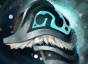

# Dota 2 → Deadlock

Иконки предметов и эффекты Dota 2 для Deadlock на Windows. В пакете — **84 предмета / 130 текстур**, Counterspell Антимага, Refresher, волна Shiva, красный Frostbite и барьеры Pavise.

Магазин и выбор героев остаются штатными. Экспериментальный интерфейс отменён после сообщения о сильных лагах и исключён из публикации. Модели героев и сторонние скины в комплект не входят.

[Соответствия предметов](docs/ITEMS.md) · [Хэндoф для агента](docs/AGENT_HANDOFF.md) · [Состав и проверка](docs/VALIDATION.md)

## Что нужно

- Установленный Deadlock в Steam на Windows.
- Python **3.10 или новее** с командой `python` и штатный Windows PowerShell. Библиотеки через `pip` не нужны.
- Закрытые Deadlock и мод-менеджер, включая его значок в трее.
- Право записи в папку игры. Запускай от обычного пользователя, если доступ уже есть.

Для готовых VPK не нужны установленная Dota 2, .NET SDK, Source 2 Viewer или мод-менеджер. Ресурсы уже упакованы.

## Установка

1. Скачай [ZIP репозитория](https://github.com/hqvdvn-cmd/dota2todeadlock/archive/refs/heads/main.zip) через **Code → Download ZIP** и распакуй вне папки игры. Либо клонируй репозиторий.
2. В Steam открой **Deadlock → Свойства → Установленные файлы → Обзор**. Нужна подпапка `game\citadel`, где находятся `gameinfo.gi` и основной `pak01_dir.vpk`.
3. Открой PowerShell в распакованной папке мода. В командах ниже замени пример пути на свой.

Сначала проверка без изменений:

```powershell
python scripts/manage.py install --game-dir "D:\SteamLibrary\steamapps\common\Deadlock\game\citadel"
```

Затем установка:

```powershell
python scripts/manage.py install --game-dir "D:\SteamLibrary\steamapps\common\Deadlock\game\citadel" --apply
```

Если проверка сообщает **Addons search path missing**, повтори проверку и установку с `--enable-addons`. Этот флаг добавляет строку `Game citadel/addons` в `SearchPaths` файла `gameinfo.gi`, предварительно сохранив оригинал:

```powershell
python scripts/manage.py install --game-dir "D:\SteamLibrary\steamapps\common\Deadlock\game\citadel" --enable-addons
python scripts/manage.py install --game-dir "D:\SteamLibrary\steamapps\common\Deadlock\game\citadel" --enable-addons --apply
```

Скрипт проверяет SHA-256 каждого пакета и занимает только `addons\pak06_dir.vpk` — `pak10_dir.vpk`. Если в одном из этих мест лежит другой мод или изменённый файл, установка остановится **до записи пакетов**. Одинаковые файлы пропускаются. Чужие VPK и `.dmm.json` сохраняются. При ошибке во время копирования скрипт пытается убрать уже добавленные им пакеты.

Путь резервной копии выводится в поле `backup`; по умолчанию это `.local\backups` внутри распакованного мода, вне игры. Там же сохраняется `receipt.json`. Не удаляй эту папку до завершения проверки. Другое место можно задать через `--backup-dir "D:\ModBackups"`.

После установки запусти тренировку. Проверь иконки в магазине и инвентаре, затем Counterspell, Refresher, Cold Front и Arctic Blast по боту. Перезапуск игры обязателен для загрузки заменённых ресурсов.

## Откат к обычным иконкам и эффектам

Закрой игру и менеджер. Из той же папки мода выполни предварительную проверку, затем удаление:

```powershell
python scripts/manage.py uninstall --game-dir "D:\SteamLibrary\steamapps\common\Deadlock\game\citadel"
python scripts/manage.py uninstall --game-dir "D:\SteamLibrary\steamapps\common\Deadlock\game\citadel" --apply
```

Будут убраны только пять пакетов с хешами из `manifest.json`; перед удалением они копируются в резервную папку. Если файл отличается, скрипт откажется удалять его. Остальные моды остаются. Пустую папку `addons` и путь её загрузки скрипт сохраняет: ими могут пользоваться другие моды.

Для повторной установки используй команду `install`. Если нужно вернуть исходный `gameinfo.gi`, сначала сравни его с копией из нужной операции: полная замена старым файлом может стереть последующие настройки или отключить другие моды. Для удаления этого мода такая замена не требуется.

## Установка вручную

При закрытых игре и менеджере сравни файлы из `packages` с [SHA256SUMS.txt](SHA256SUMS.txt), затем скопируй их в `Deadlock\game\citadel\addons`. Не заменяй занятые другим модом имена. В `gameinfo.gi`, внутри `FileSystem → SearchPaths`, строка `Game citadel/addons` должна находиться **выше** `Game citadel`. Меняй только эту строку и сохраняй резервную копию конфигурации.

Для ручного отката вынеси эти же пять файлов из игры, сверив хеши. Не удаляй папку `addons` целиком. Если слоты заняты, перед установкой нужно разобраться в существующих пакетах; универсального безопасного перенумерования здесь нет.

## Совместимость и статус

Пакет собран **17 октября 2026** по тогдашним ресурсам игры. Counterspell, Refresher, Shiva/Frostbite и оболочка Pavise проверялись владельцем в тренировке. Полный набор срабатываний Reactive Barrier, Indomitable и Weapon Shielding не проверен. Последняя смена Restorative Shot на Chaos Strike прошла файловую проверку; отдельного подтверждения в игре пока нет.

`pak09` содержит в том числе модифицированные определения с визуальными привязками барьеров. После обновления Deadlock они могут устареть: убери `pak09` и `pak10` до проверки по новой базе, а при общей неисправности выполни полный откат. Установка скриптом проверяет состав файлов, а не совместимость с новым патчем игры.

Мод-менеджер может пересоздать `addons` при синхронизации. Эти пять пакетов не регистрируются отдельными карточками менеджера. После его операций сверяй файлы повторно.

## Для агента и разработчика

Начни с [docs/AGENT_HANDOFF.md](docs/AGENT_HANDOFF.md). Там перечислены пакеты, границы изменений, установка, откат и проверки. Проверки управляющего скрипта запускаются так:

```powershell
python -m unittest discover -s tests -v
```

Готовые игровые ресурсы находятся в `packages`; таблица соответствий — в `docs/item-mapping.json`. Репозиторий не содержит локальные SDK, полные игровые архивы, историю неудачных пробников и инструменты для пересборки эффектов. Это дистрибутив с исходником управляющего скрипта.

## Ресурсы

Изображения и эффекты взяты из Dota 2 и Deadlock. Игровые ресурсы и названия принадлежат Valve. Это неофициальный мод. Перекраски и составные иконки выполнены программно из оригиналов. Подробнее: [CREDITS.md](CREDITS.md).
