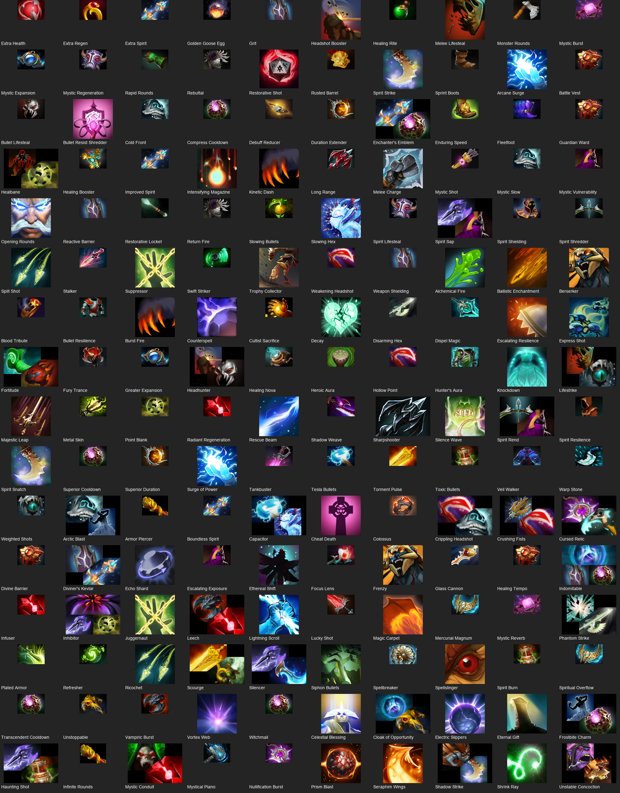
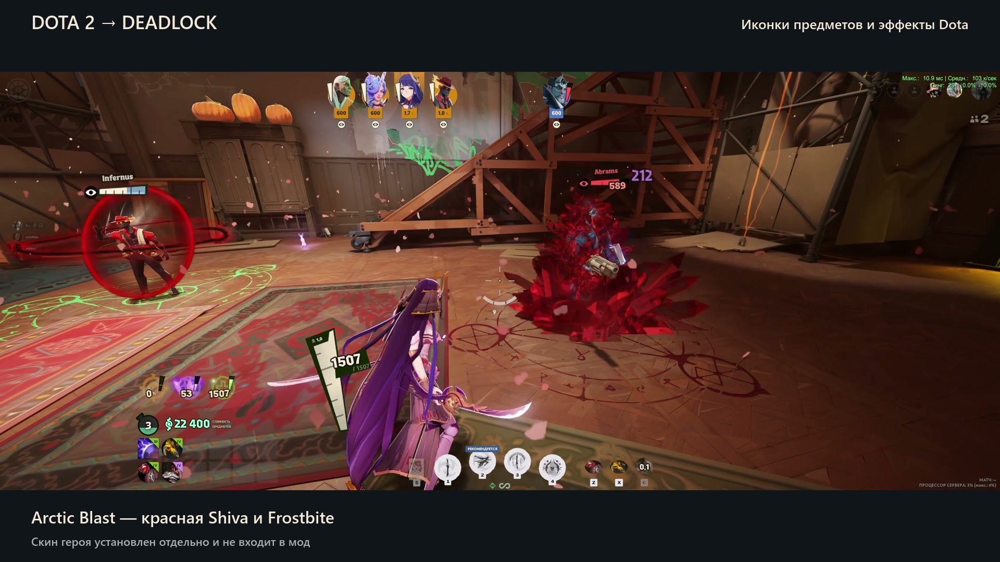

**English** · [Русский](README.ru.md)

# Dota 2 → Deadlock

Bring Dota 2 item icons and spell effects into Deadlock.

- **160 item definitions** use Dota icons selected by their gameplay purpose, including 25 composite icons and a black Sharpshooter. Another 13 keep their original icons.
- Anti-Mage’s **Counterspell** shield and the green **Refresher** spiral.
- **Shiva’s Guard** for Cold Front, plus a red Arctic Blast wave and Frostbite.
- **Pavise** barriers in cyan, gold and red, with shared appearance, hit and break effects.

[Download ZIP](https://github.com/hqvdvn-cmd/dota2todeadlock/archive/refs/heads/main.zip) · [Item list (RU)](docs/ITEMS.md)

## Preview



[Composite icons at full size](assets/demo/composites-v14.png). The list includes upgrades and mode-specific definitions; it is not a count of items in the current shop. Some shared legacy HUD textures keep their native image to avoid conflicting replacements.

The video and in-game screenshots below show the earlier v12 release.

[](assets/demo/showcase.mp4)

**[Watch the 27-second showcase](assets/demo/showcase.mp4)** · [Download video](https://github.com/hqvdvn-cmd/dota2todeadlock/raw/refs/heads/main/assets/demo/showcase.mp4)

The character skin shown in the footage is a separate mod and is not included.

<details>
<summary>Screenshots: items and effects</summary>

**Item icons — click an image to view it at full size.**

<a href="assets/demo/items-800-1600.png"></a>
<a href="assets/demo/items-3200.png"></a>
<a href="assets/demo/items-6400.png"></a>

**Pavise: cyan, gold and red variants.**

<a href="assets/demo/pavise-cyan.png"></a>
<a href="assets/demo/pavise-gold.png"></a>
<a href="assets/demo/pavise-red.png"></a>

**Cold Front / Shiva.**


</details>

## Requirements

- Deadlock installed through Steam on Windows.
- [Python 3.10 or newer](https://www.python.org/downloads/windows/) for the installer.

## Install

1. [Download the ZIP](https://github.com/hqvdvn-cmd/dota2todeadlock/archive/refs/heads/main.zip) and extract it outside the game folder.
2. Close Deadlock and your mod manager, including its tray icon.
3. In Steam, open **Deadlock → Properties → Installed Files → Browse**. Open `game\citadel` inside that folder and copy its path.
4. Open PowerShell in the extracted mod folder and run the command below. **Replace the example game path with your own.**

```powershell
python scripts/manage.py install --game-dir "D:\SteamLibrary\steamapps\common\Deadlock\game\citadel" --enable-addons --apply
```

The installer sets up addon loading and keeps the game's own configuration paths available. It backs up the configuration before changing it. Backups are saved in `.local\backups` inside the extracted mod folder. Keep that folder.

If the installer reports an occupied or modified addon, stop and check your other mods. Do not overwrite the conflicting file.

## Launch with mods

Wait for any Steam game update to finish, then run this from the mod folder with the game and mod manager closed. Replace the game path with your own:

```powershell
python scripts/manage.py launch --game-dir "D:\SteamLibrary\steamapps\common\Deadlock\game\citadel" --apply
```

This checks the game's native ability resource, restores addon loading if `gameinfo.gi` was reset, backs up any configuration change, and asks Steam to launch Deadlock. It refuses a changed ability resource or missing/modified mod package. It does not run Steam's file verification. Use this command each time you play with mods; a separate mod manager is optional.

If Steam starts an update after the command, let it finish, close the game if it opened, and run the command again. Restoring addon loading does not make an outdated mod compatible with a new game build.

### Updating the mod

Before replacing your mod folder, close the game and uninstall using the command in your **old copy** below. Extract the new ZIP to a separate folder, then install from that folder. Keep your backups. A new copy refuses to overwrite packages from an older release.

### Game stops with “Unable to read default keybinding configuration”

Update the mod as described above, then use the launch command. It also repairs the loading configuration when the current mod files are already installed. You do not need to reset your keys or delete your saves.

## Uninstall

Close the game and mod manager. From the same mod folder, run:

```powershell
python scripts/manage.py uninstall --game-dir "D:\SteamLibrary\steamapps\common\Deadlock\game\citadel" --apply
```

This removes this mod’s packages and leaves your other mods in place. Restart the game to return to the original item icons and effects.

<details>
<summary>Manual installation</summary>

Back up `game\citadel\gameinfo.gi`. Copy the five files from `packages` into `game\citadel\addons` without overwriting another mod. In `gameinfo.gi`, under `FileSystem → SearchPaths`, put `Game citadel/addons` above `Game citadel`. Also make sure these four entries exist inside the same block:

```text
Mod   citadel
Write citadel
Mod   core
Write core
```

Keep the existing `Game citadel`, `Game core`, language and other entries. Do not add just the addons line: the explicit `Mod` and `Write` entries are needed to keep the default keybinding configuration available.

To uninstall manually, remove only this mod’s `pak06_dir.vpk` through `pak10_dir.vpk` after checking them against [SHA256SUMS.txt](SHA256SUMS.txt). Keep the rest of `addons`.

</details>

## Compatibility

Rebased on the **October 21, 2026** ability resource, identical in builds **26090082** and **26091806**. Installation and scripted launch check that native resource directly. A matching hash covers this resource only; future updates can affect other assets. Manual installation and mod managers do not run this check.

The owner reported normal behavior after a local game check with this update installed. This was a combined local setup with separate hero mods, not a clean Dota-only match test. The reported earlier match crash has not been traced to a specific package. Shared barrier effects also apply to barriers granted by hero abilities.

Unofficial fan mod using Dota 2 and Deadlock assets by Valve. [Credits](CREDITS.md).
