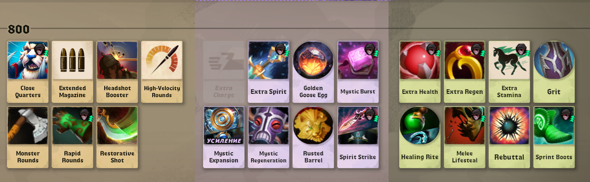
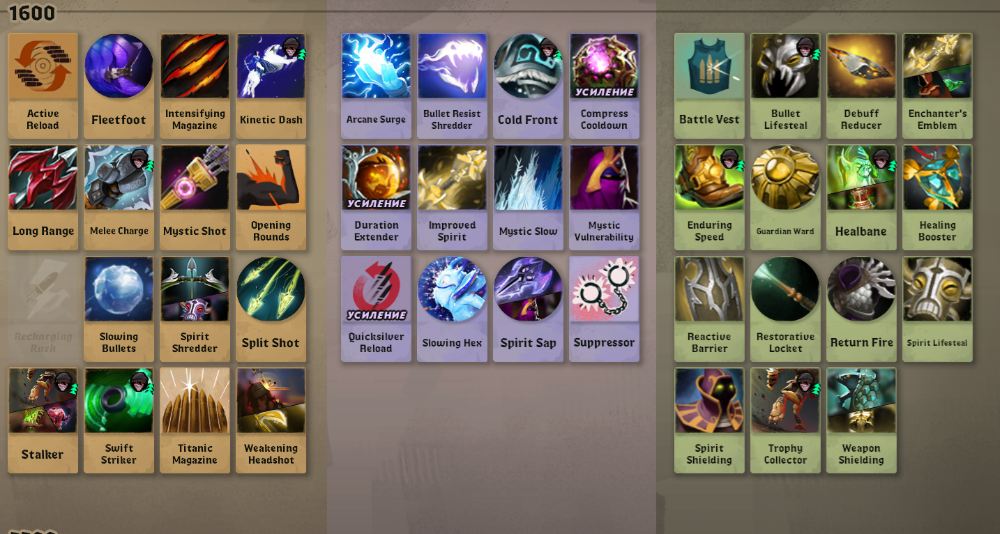
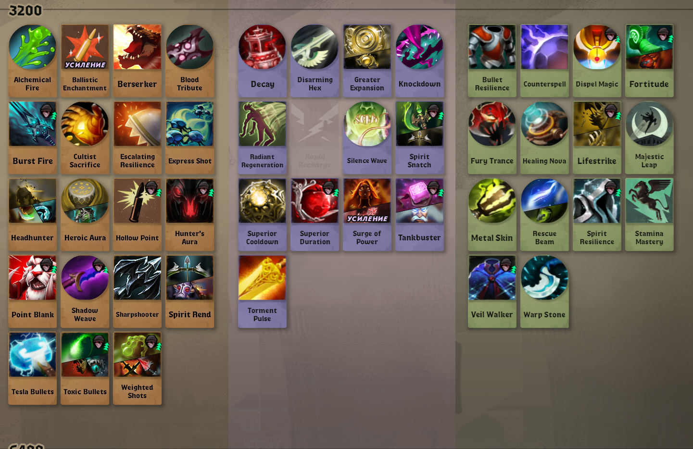
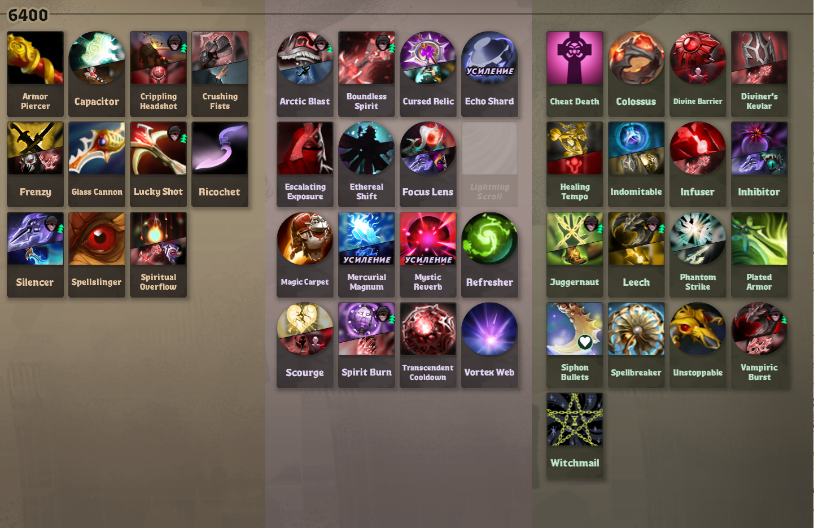

**English** · [Русский](README.ru.md)

# Dota 2 → Deadlock

[GameBanana](https://gamebanana.com/mods/729017) · [GitHub release](https://github.com/hqvdvn-cmd/dota2todeadlock/releases/tag/v27)

Dota 2 item and ability icons for Deadlock, with Counterspell, Refresher, Shiva and Pavise effects.

The icons are chosen for similar effects. Items with several bonuses can combine two or three Dota images, and stronger bonuses use gold or red variants. Item names, prices and stats stay as they are in Deadlock.

Included effects:

- Counterspell: Anti-Mage’s shell.
- Refresher: the green Dota spiral.
- Cold Front: Shiva’s wave. Arctic Blast uses a red wave and Frostbite crystals.
- Barriers: Pavise shells, with cyan, gold and red variants. This also affects shared barriers from hero abilities.

Character skins and voices aren’t part of this pack.

## Download

Download **dota2-to-deadlock-v27-dmm.zip** from the [V27 release](https://github.com/hqvdvn-cmd/dota2todeadlock/releases/tag/v27). Close Deadlock, disable the old version, import the ZIP into your mod manager and enable all five components. GameBanana also has one-click install buttons.

## Manual installation

1. Close Deadlock and your mod manager. Back up `game/citadel/gameinfo.gi` and any older files from this mod.
2. In Steam, open Deadlock → Properties → Installed Files → Browse, then open `game/citadel`.
3. Copy the five VPK files into `game/citadel/addons`. In the full repository ZIP they are in `packages`; in the V27 release archive they are at the archive root. Do not overwrite another mod’s files.
4. In `gameinfo.gi`, find `FileSystem` → `SearchPaths`. Place `Game citadel/addons` above `Game citadel`. Keep the existing game/language paths and make sure these entries are present:

```text
Game  citadel/addons
Mod   citadel
Write citadel
Mod   core
Write core
```

To update, remove only the previous copy of this pack before copying the new files. To uninstall, remove this pack’s five VPKs after checking [SHA256SUMS.txt](SHA256SUMS.txt). Keep other files in `addons`.

### Optional Python installer

The GitHub ZIP also has an installer that checks the current native ability resource and backs up configuration changes. Python 3.10+ is required. Replace the game path with yours:

```powershell
python scripts/manage.py install --game-dir "D:/SteamLibrary/steamapps/common/Deadlock/game/citadel" --enable-addons --apply
python scripts/manage.py launch --game-dir "D:/SteamLibrary/steamapps/common/Deadlock/game/citadel" --apply
```

For removal, use `uninstall` instead of `install` and omit `--enable-addons`, from the same extracted folder. Keep `.local/backups`.

## Screenshots

Current V27 shop icons, supplied by the mod’s owner.









The [item table](docs/ITEMS.md) lists each replacement. [Earlier effect screenshots and video](assets/demo/README.md) are from V19.

V27 includes the startup fix for the October 30 update (client6833). Future game patches may need another update. If something breaks, include the item name and a screenshot or clip in your report.

Original artwork and effects: Valve. [Credits and AI usage](CREDITS.md).
