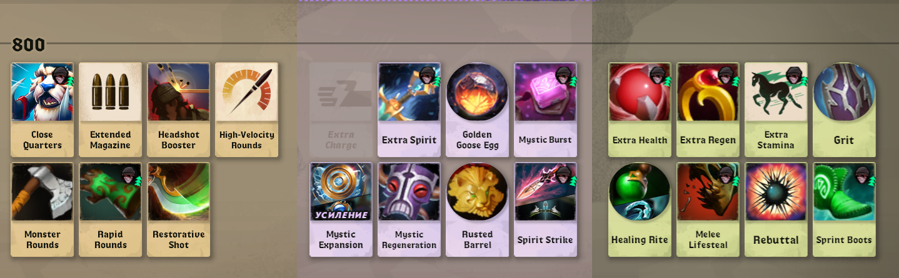
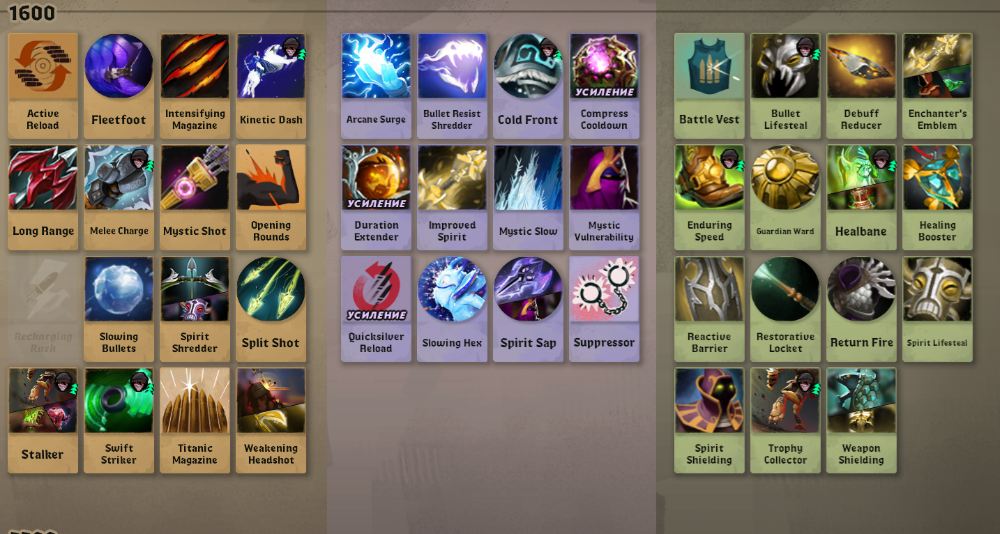
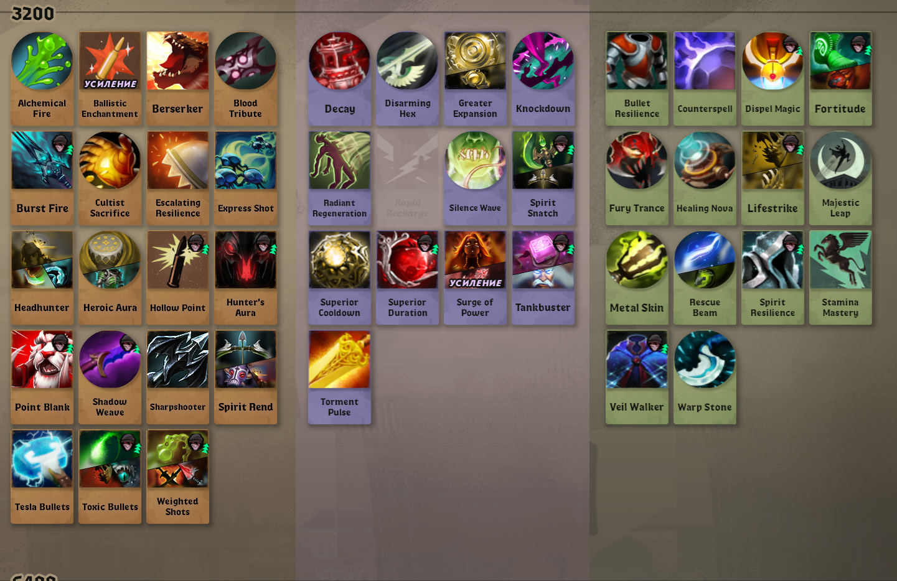
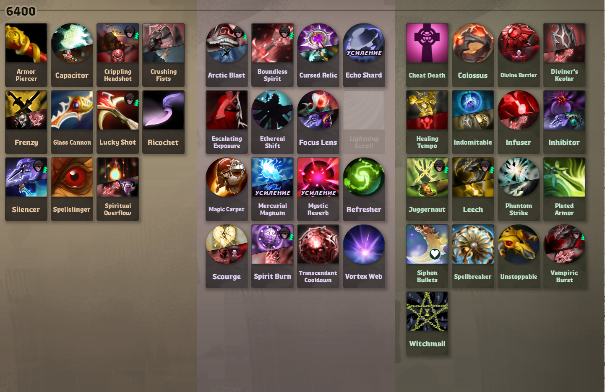

[English](README.md) · **Русский**

# Dota 2 → Deadlock

[GameBanana](https://gamebanana.com/mods/729017) · [GitHub release](https://github.com/hqvdvn-cmd/dota2todeadlock/releases/tag/v27)

Иконки предметов и способностей Dota 2 для Deadlock, а также эффекты Counterspell, Refresher, Shiva и Pavise.

Иконки подобраны по похожим эффектам. Для предметов с несколькими бонусами используются две или три картинки; более сильные бонусы выделены жёлтым или красным. Названия, цены и характеристики остаются из Deadlock.

В паке:

- Counterspell — оболочка Антимага.
- Refresher — зелёная спираль из Dota.
- Cold Front — волна Shiva. У Arctic Blast красная волна и кристаллы Frostbite.
- Барьеры — оболочки Pavise голубого, золотого и красного цвета, в том числе для барьеров способностей героев.

Скины героев и озвучка в этот пак не входят.

## Скачать

Архив **dota2-to-deadlock-v27-dmm.zip** — в [релизе V27](https://github.com/hqvdvn-cmd/dota2todeadlock/releases/tag/v27). Закрой Deadlock, отключи старую версию, импортируй ZIP в менеджер модов и включи все пять компонентов. На GameBanana также есть кнопки установки в один клик.

## Установка вручную

1. Закрой Deadlock и менеджер. Сохрани копию `game/citadel/gameinfo.gi` и файлов предыдущей версии мода.
2. В Steam открой Deadlock → Свойства → Установленные файлы → Обзор, затем перейди в `game/citadel`.
3. Скопируй пять VPK в `game/citadel/addons`. В ZIP полного репозитория они лежат в `packages`, в архиве релиза V27 — в корне. Чужие моды не перезаписывай.
4. В `gameinfo.gi` найди `FileSystem` → `SearchPaths`. Поставь `Game citadel/addons` выше `Game citadel`. Сохрани остальные игровые и языковые пути и проверь наличие строк:

```text
Game  citadel/addons
Mod   citadel
Write citadel
Mod   core
Write core
```

При обновлении сначала убери файлы предыдущей версии этого пака. Для удаления убери только его пять VPK, сверив их с [SHA256SUMS.txt](SHA256SUMS.txt). Остальное содержимое `addons` сохрани.

### Необязательный Python-установщик

В GitHub ZIP есть скрипт, который проверяет штатный файл способностей и сохраняет копию конфигурации перед правкой. Нужен Python 3.10+. Замени путь к игре на свой:

```powershell
python scripts/manage.py install --game-dir "D:/SteamLibrary/steamapps/common/Deadlock/game/citadel" --enable-addons --apply
python scripts/manage.py launch --game-dir "D:/SteamLibrary/steamapps/common/Deadlock/game/citadel" --apply
```

Для удаления замени `install` на `uninstall` и убери `--enable-addons`. Выполняй из той же распакованной папки. Сохрани `.local/backups`.

## Скриншоты

Текущие иконки V27 в магазине. Скриншоты предоставлены владельцем мода.









Все соответствия перечислены в [таблице предметов](docs/ITEMS.md). [Старые скриншоты эффектов и видео](assets/demo/README.md) относятся к V19.

В V27 включён фикс запуска после обновления Deadlock от 30 октября (client6833). После следующих патчей может потребоваться новый фикс. В сообщении об ошибке укажи предмет и приложи скриншот или видео.

Оригинальные изображения и эффекты — Valve. [Авторы и использование ИИ](CREDITS.md).
