[English](README.md) · **Русский**

# Dota 2 → Deadlock

[](https://gamebanana.com/mods/729017)
[](https://gamebanana.com/mods/729017#Files)

Иконки и эффекты Dota 2 для Deadlock. Соответствия выбраны по действию предметов: вампиризм, снижение брони, барьеры и другие механики. У составных предметов несколько Dota-иконок, у улучшений — золотые и красные варианты.

Из эффектов уже перенесены Counterspell, Refresher, Shiva’s Guard для Cold Front, Arctic Blast/Frostbite и барьеры Pavise. Появление, попадания и разрушение барьеров изменены также у способностей героев. Дальше планируется перенос других Dota-эффектов.

В V25 заменены 154 определения предметов, ещё 19 сохраняют родные иконки. В [таблице](docs/ITEMS.md) есть улучшения и режимные варианты. Скины героев и озвучка в комплект не входят.

## Скачать

[Архив V25](https://github.com/hqvdvn-cmd/dota2todeadlock/releases/tag/v25) · [ZIP полного репозитория](https://github.com/hqvdvn-cmd/dota2todeadlock/archive/refs/heads/main.zip) · [GameBanana](https://gamebanana.com/mods/729017#Files)

V25 можно скачать на GitHub. На GameBanana размещается архив для мод-менеджеров.

В разделе файлов GameBanana есть установка через **Deadlock Mod Manager**, **Grimoire Mod Manager** и **HELLCAT**. Отключи старую версию, установи новый архив и включи все пять компонентов.

## Установка вручную

1. Закрой Deadlock и менеджер. Сохрани копию `game/citadel/gameinfo.gi` и файлов предыдущей версии мода.
2. В Steam открой Deadlock → Свойства → Установленные файлы → Обзор, затем перейди в `game/citadel`.
3. Скопируй пять VPK в `game/citadel/addons`. В ZIP полного репозитория они лежат в `packages`, в архиве релиза V19 — в корне. Чужие моды не перезаписывай.
4. В `gameinfo.gi` найди `FileSystem` → `SearchPaths`. Поставь `Game citadel/addons` выше `Game citadel`. Сохрани остальные игровые и языковые пути и проверь наличие строк:

```text
Game  citadel/addons
Mod   citadel
Write citadel
Mod   core
Write core
```

При обновлении сначала убери файлы предыдущей версии этого пака. Для удаления убери только его пять VPK, сверив их с [SHA256SUMS.txt](SHA256SUMS.txt). Остальное содержимое `addons` сохрани.

### Необязательный Python-установщик

В GitHub ZIP есть скрипт, который проверяет штатный файл способностей и сохраняет копию конфигурации перед правкой. Нужен Python 3.10+. Замени путь к игре на свой:

```powershell
python scripts/manage.py install --game-dir "D:/SteamLibrary/steamapps/common/Deadlock/game/citadel" --enable-addons --apply
python scripts/manage.py launch --game-dir "D:/SteamLibrary/steamapps/common/Deadlock/game/citadel" --apply
```

Для удаления замени `install` на `uninstall` и убери `--enable-addons`. Выполняй из той же распакованной папки. Сохрани `.local/backups`.

## Демонстрация

В V25 переработаны 52 составные иконки: второстепенные части сдвинуты внутрь, чтобы их было видно в круглых слотах HUD. Изображения и цвета улучшений соответствуют текущей таблице предметов. Ниже — рендеры новых иконок; игровые скриншоты и видео дальше относятся к V19.

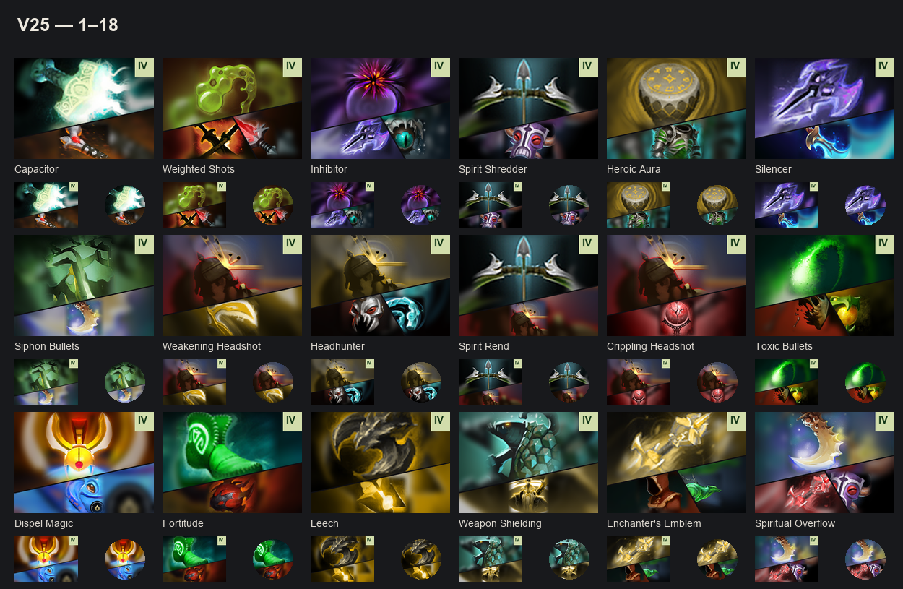


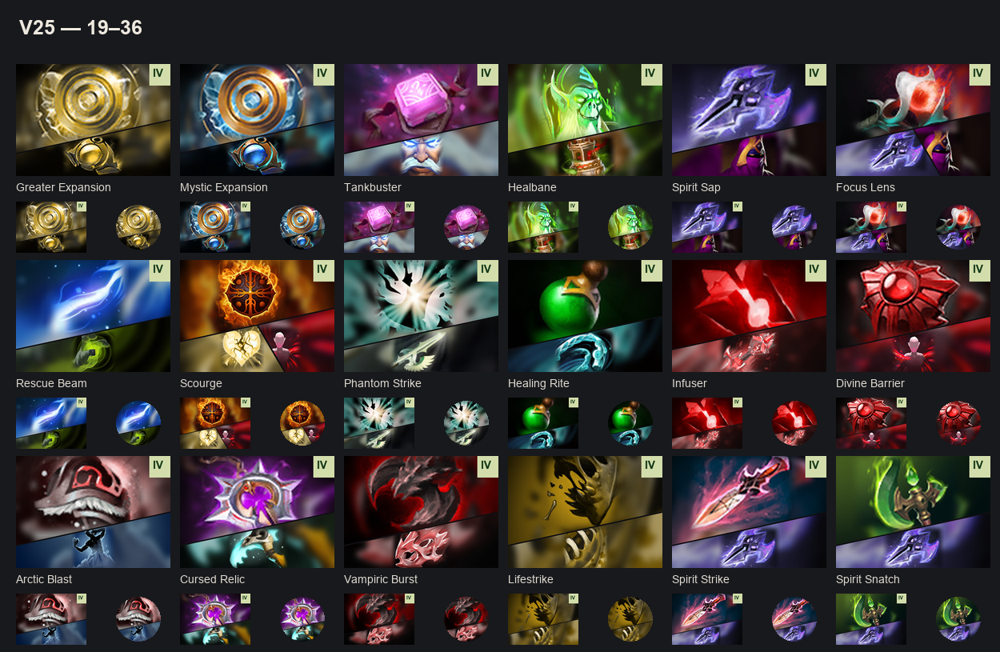


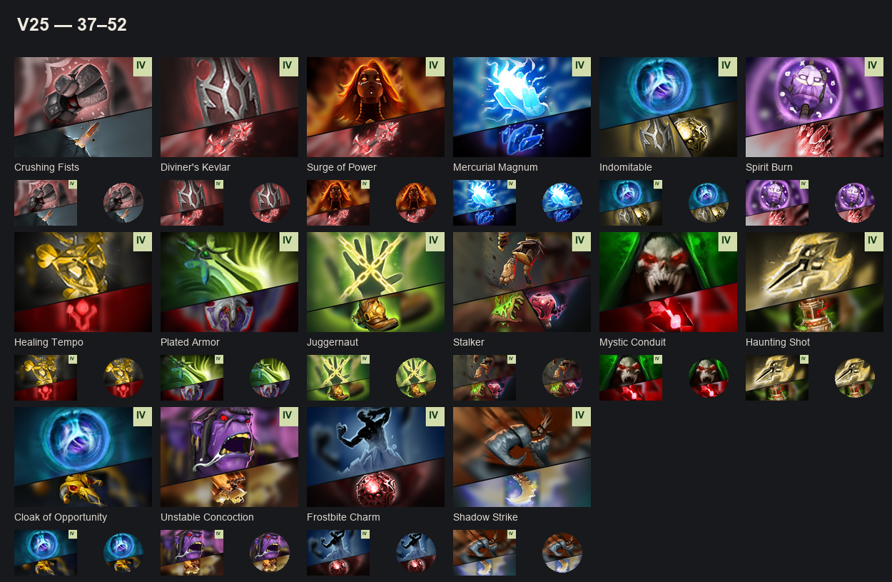


[Полное минутное видео](https://github.com/hqvdvn-cmd/dota2todeadlock/releases/download/v19/dota2-to-deadlock-v19-showcase.mp4)

Скриншоты и видео предоставлены для V19. Скин героя установлен отдельно и в мод не входит.

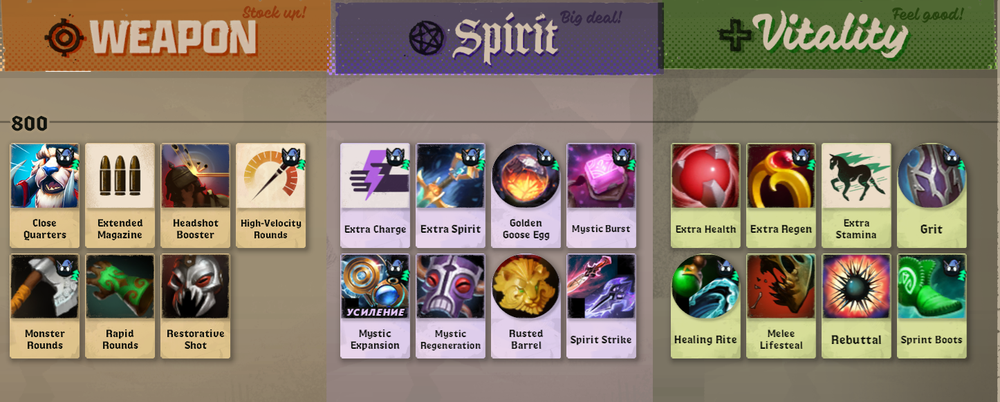

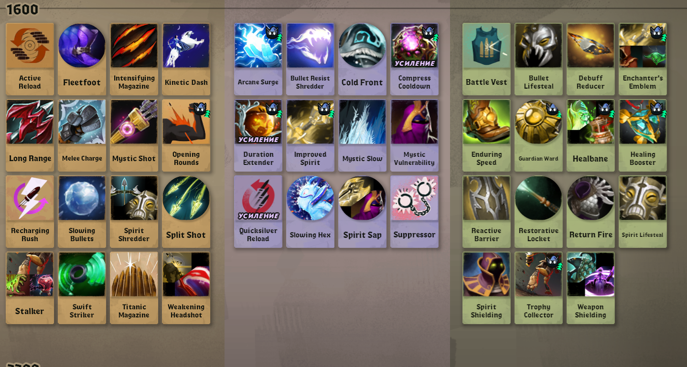

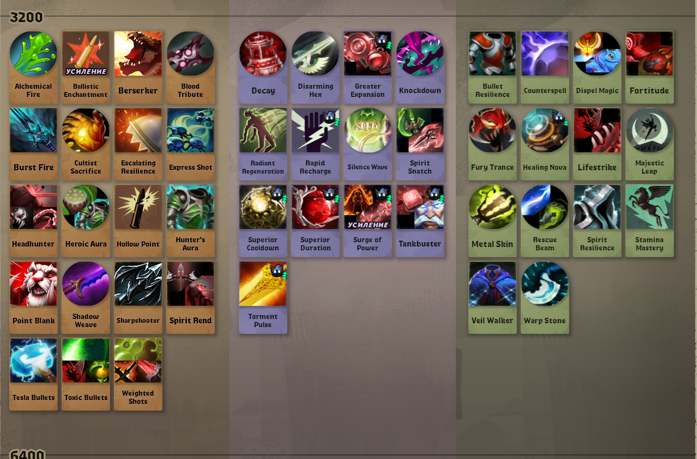

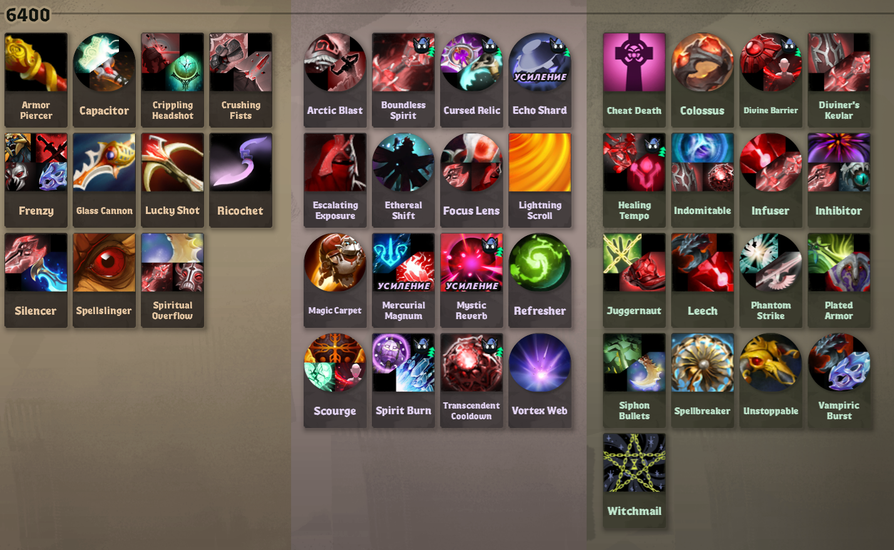

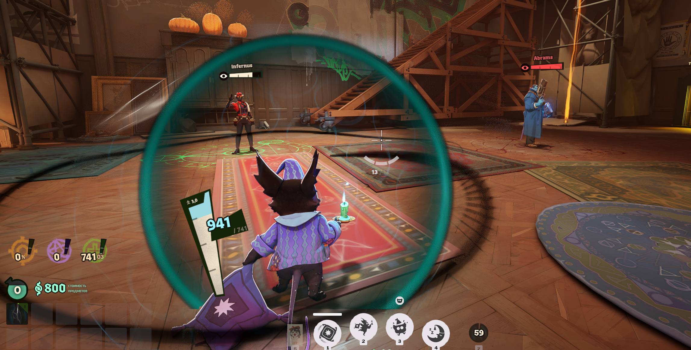

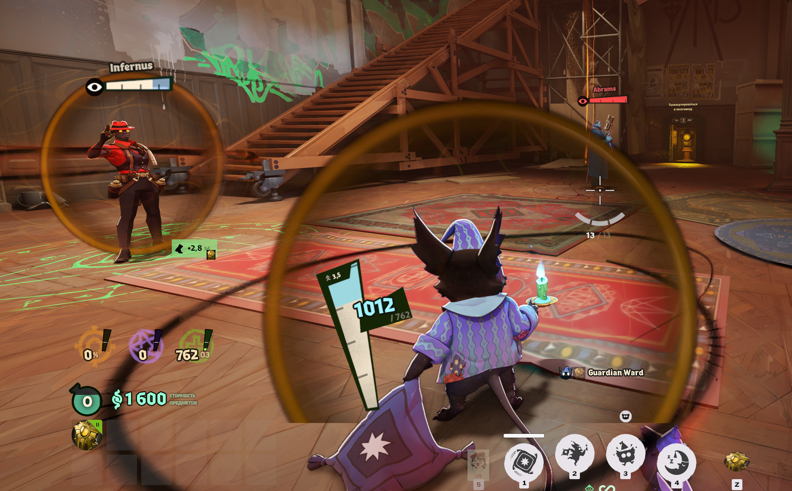

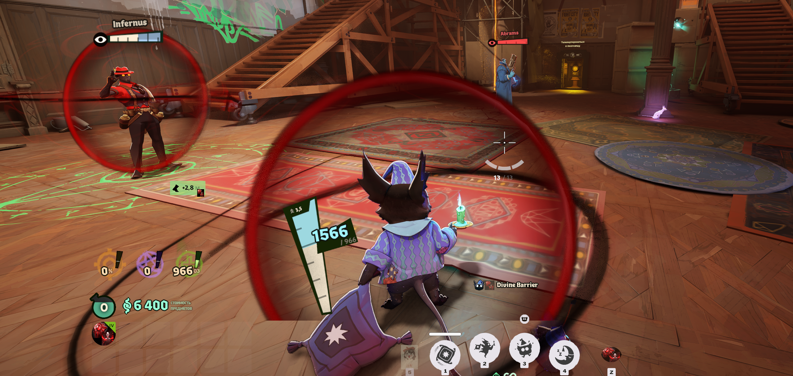

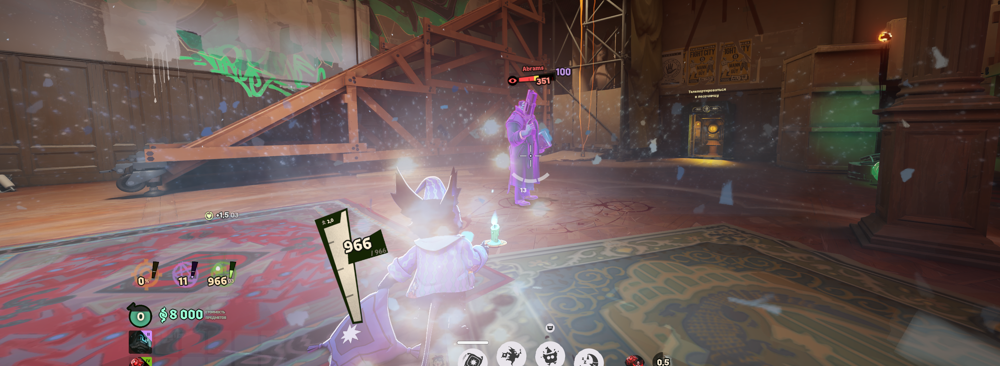

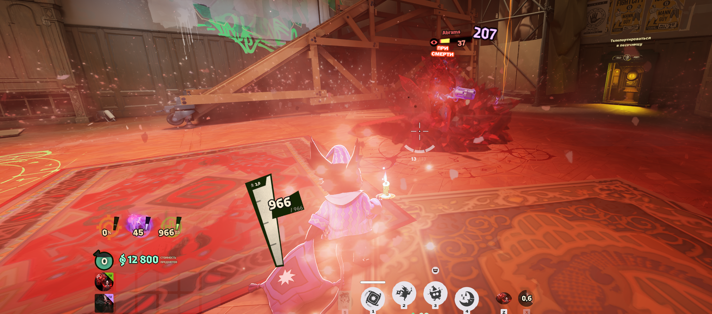

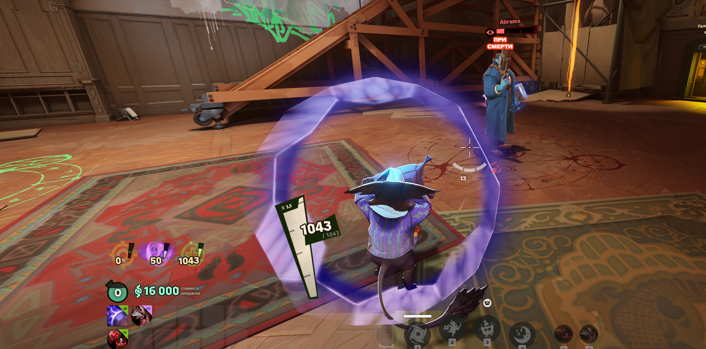

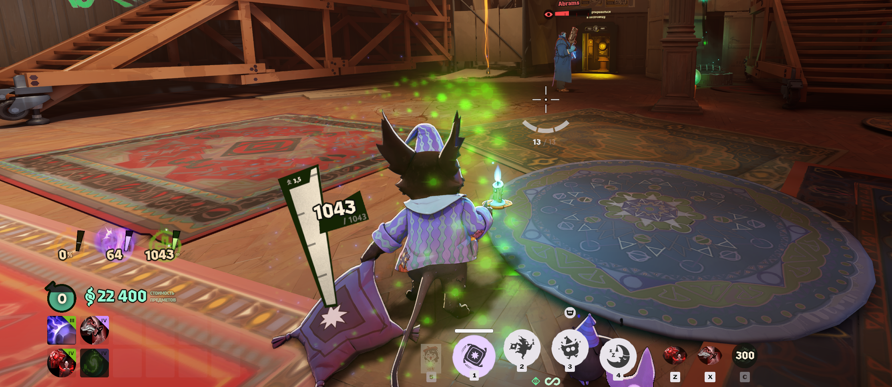

## Совместимость

База — игровые ресурсы от 21 октября. Патч Deadlock может сломать замену ресурсов или сбросить загрузку модов. Python-установщик проверяет штатный файл способностей; менеджеры и ручное копирование эту проверку не запускают. На новых скриншотах видны все четыре ценовых тира и Mystic Slow с иконкой Лича. Видео показывает названные эффекты в общем комплекте модов; остальные срабатывания и отдельный standalone-матч не проверялись.

Для [Шуры](https://github.com/hqvdvn-cmd/sekiro-shura-deadlock) используй её D2D-патч привязки ульты. Две полные замены файла способностей требуют совместимой сборки.

Если найдёшь баг, напиши предмет/эффект, сборку игры и другие установленные моды. Приложи скриншот или короткий ролик.

Оригинальные ресурсы: Valve. [Авторы](CREDITS.md).
